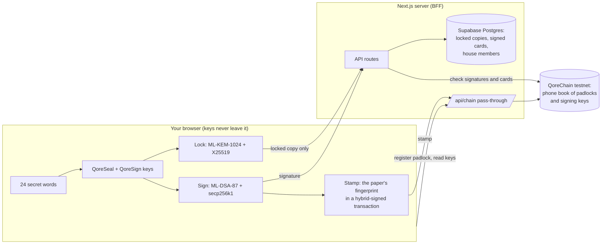

# Lockhouse

**Your peace, under lock and key. Not even Q-Day gets in.**

[](https://build.qorechain.io/p/lockhouse)

Lockhouse is a house for your family's important papers. Everything you put in is locked on your own device first, for you and the people you pick, with a lock that quantum computers can't break. The locked copies can sit anywhere: a stranger's copy opens nothing, today or after Q-Day.

Built for QoreChain's **Build Before Q-Day** hackathon (Encrypted Apps). It runs on QoreChain's test network (`qorechain-diana`), never mainnet.

- **Live demo: https://lockhouse-qorechain.vercel.app** (QoreChain testnet)
- Demo video: _added at submission_

## Try it

**In one minute, no account:** open the [live demo](https://lockhouse-qorechain.vercel.app) and press **Play the Thief**. You break in, steal every locked copy and try to open them. Then Q-Day comes, and they still don't open.

**The whole thing (about 10 minutes):** you need two people, so use two browser profiles (or two devices). Each profile is one person, and both do steps 1 to 3.

1. Press **Make Your Keys**. Write down the 24 secret words.
2. Get free test QOR at the [faucet](https://dashboard.qorechain.io/faucet) (it asks you to sign in there). Test QOR is play money for the test network; it pays the small network fees.
3. Press **Register My Padlock**. This puts your public padlock on the test chain (two small transactions). The page then shows your `qor1` address.
4. Sign in. In the first profile, press **Add Someone** and paste the second person's `qor1` address.
5. Press **Put In a Paper**, pick a file or write a note, and tick the second person.
6. In the second profile, open it. You see "Signature Checked on QoreChain" and "Stamped on QoreChain · {date}".

To look at a stamp yourself, press its link: the explorer opens on Mainnet, so switch it to **Testnet** at the top.

## Testnet addresses

The three accounts in the demo video. Each one registered its padlock and signing key on `qorechain-diana`. Accounts 1 and 2 also stamped papers there (each stamp is a transaction with the memo `lockhouse-stamp-v1|…`).

| Account | Address |
| --- | --- |
| Demo account 1 | `qor1w0c3th6k7gu3ptylnz6ngv2lskw6vaa29s60ha` |
| Demo account 2 | `qor17dpfdmax8fkvjl8w9ap6hhjmcuc9eldc02zgmh` |
| Demo account 3 | `qor1wyhu6v6r847t29l2ag3yef5r3e4fwxpw9pkntk` |

Look them up at [explore.qore.network](https://explore.qore.network) (switch to Testnet first).

## The problem

Photos of ID cards and family papers sit in chats, phone galleries and cloud backups. Anyone who gets a copy can read it. And copies locked the old way (with today's padlocks) will open once a big enough quantum computer exists. That day is called **Q-Day**.

## What it does

The rule: **this is a house, not everyone can enter.**

1. **Make your keys.** 24 secret words, made in your browser. They never leave it.
2. **Register your padlock.** Your public ML-KEM-1024 key (the padlock) goes into QoreChain's public phone book, next to your ML-DSA-87 signing key. A **signed card** ties both to your address, so nobody can slip in a fake padlock for you.
3. **Sign in** with your key (Sign In With QoreChain). No password.
4. **Build the house.** Add the people you trust by their `qor1` address. Their card is checked against the chain first.
5. **Put in a paper.** Pick a file or write a note, tick who can open it. It is locked on your device (ML-KEM-1024 + X25519, one locked copy for all readers), signed with your key, and **stamped on QoreChain** before anything is sent. The server only ever stores the locked copy.
6. **Open it.** A reader's browser checks the sender's signature and the paper's stamp on chain, then opens the copy. A paper with a signature that doesn't check out is shown blurred, with "Signature Not Proven". The stamp shows when the paper was put in ("Stamped on QoreChain · {date}"), or "Not Stamped", or "Stamp Doesn't Match".
7. **The Q-Day Drill (Simulation).** Anyone can play the thief, no account needed: **Play the Thief** on the Welcome page. Break in and steal every stored copy, try to open them (QoreSeal really refuses each one), then wait for Q-Day: the old lock (X25519) breaks, and still nothing opens, because every copy also carries ML-KEM-1024. It ends "You stole {n} papers. You opened 0."

Also built: **change readers** (the person who put a paper in can add or remove who can open it: their browser locks the same paper again for the new list, signs it and stamps it again), remove someone from the house, a Papers page with search (title words and sender), a fake drop-in (a pretend hacked server slips in a paper it can't sign; no button in the app, used for the video and the tests), and a **recovery key** for the house (a second set of 24 words, kept on paper, that is one more reader of every paper put in after it was made).

## How it works



- **Locking:** `@qorechain/qoreseal` seals one hybrid envelope (ML-KEM-1024 + X25519) with one entry per reader, and the paper's id as extra checked data, so a copy can't be moved to another paper.
- **Signing:** `@qorechain/qoresign` signs `lockhouse-item-v1|house|item|title|sha256(envelope)`. The server checks it against the sender's key on chain before it stores anything, and every reader checks it again.
- **Phone book:** padlocks and signing keys are registered on chain in two transactions per person (a small test-QOR fee, like a delivery fee for the network).
- **Stamp:** each paper also gets a stamp: a tiny transaction from the sender to themselves (0.000001 QOR plus about 0.02 test QOR in fees), signed with ML-DSA-87 and secp256k1, whose memo is `lockhouse-stamp-v1|sha256(the signed text)`. The block time proves when the paper was put in, and nobody (our server included) can change or back-date it. It is sent before the paper is saved: if the stamp fails, nothing is saved. The server and every reader check it with QoreSign's `inspectTransaction`, which also checks the ML-DSA-87 signature against the sender's key in the phone book. The explorer shows it as "quantum-safe, verified on-chain".
- **Server:** Next.js route handlers with the Supabase service role key. Tables have row-level security on and no policies, so the public Supabase API gets nothing. Sessions are signed, httpOnly cookies.

## Stack

Next.js 16 (App Router) + TypeScript + Tailwind 4 · Supabase Postgres · Vercel · Vitest · `@qorechain/qoreseal` 0.1.0 · `@qorechain/qoresign` 0.2.0 · cosmjs · `@scure/bip39`. No smart contract.

## Run it locally

```bash
npm install
cp .env.example .env.local          # then fill SUPABASE_URL and SUPABASE_SERVICE_ROLE_KEY
npm run test:accounts               # makes SESSION_SECRET and 3 throwaway test accounts, prints their addresses
# apply supabase/migrations/*.sql to your Supabase project, in order
# fund the 3 addresses with test QOR at https://dashboard.qorechain.io/faucet
npm test                            # Vitest: unit + integration (Supabase + testnet)
npm run dev                         # http://localhost:3000
```

`npm run build && npm run check:build` builds and checks that no server secret ended up in the browser files.

## Honest limits

What Lockhouse does not do, in plain words:

- **The lock hides what's inside, not the rest.** Who sent something to whom, when, how big it is, and the title are not hidden. Titles are seen by everyone in the house.
- **Once someone opens a paper, it's on their device.** That's why the house is only for people you trust.
- **Removing someone doesn't take back what they already opened.** It only stops them opening the house from now on.
- **Lost secret words lose what was locked for them,** unless the house made a recovery key before that paper was put in.
- **The recovery key only opens papers put in after it was made,** or whose readers were changed after it was made. Other papers can't be opened with its words.
- **If the person who made the recovery key is removed, the key is dropped** (they saw its words). The house can make a new one. Papers already locked to the old key still open with the old words.
- **Removing a reader doesn't take back a copy they already opened.** It only stops them opening it here from now on.
- **Changing readers is trust in the person who put the paper in.** The server can't see inside the new copy, so they could also swap what is inside. It is signed and stamped again by them, and only they can change it.
- **If the person who put a paper in has left the house, no one can change its readers.**
- **It protects things from now on.** Papers that already leaked stay leaked.
- **A stamp is public.** Anyone can see on the testnet that an address stamped something, and when. The memo is a fingerprint of the signed text (house, paper, title, locked copy), so it doesn't say what the paper is or who can open it, and it can't be matched to a copy in the public store. Each paper costs its sender a small test-QOR fee.
- **A stamp proves when, not what.** It shows the paper existed in this form at that time. A hacked server could still strip a stamp from its copy; readers then see "Not Stamped". Papers put in before stamps existed show "Not Stamped" too.
- **It doesn't stop someone stealing a locked copy; it makes the copy useless.** A hacked phone, laptop or browser extension is outside it: your secret words live in this browser's storage.
- **The member list lives on our server.** The server can't open a paper or fake a signature, but a hacked server could hide, delete or refuse to store a locked copy, or add a stranger to the member list. Lockhouse shows every member by name and address, and who made the recovery key; check the list before you pick readers.
- **Names are what each person types.** They are not unique; the address next to each name is what counts.
- **Any member can add someone whose own house is empty,** without asking them first.
- **The drill is pretend, and says so.** The steal and the failed opening are real (the store is public, and QoreSeal refuses each copy). Only Q-Day is pretend: no one can break X25519 today, and members' old keys never leave their devices, so the page shows the old lock as broken and then reads that each copy still carries ML-KEM-1024. Test T-0.3 does the real check: a reader's X25519 key without their ML-KEM-1024 key doesn't open a copy.
- **The fake drop-in is real data.** It stores a marked paper ("Fake Drop-In (Simulation)") in your house list. The app has no button for it; it is made through its route for the video and the tests.
- **QoreSeal is a draft.** QoreChain calls it a draft until an outside review before version 1.0.
- **It runs on QoreChain's test network.** The explorer link opens on Mainnet; switch it to Testnet at the top.

## Security review

This is a hackathon review, not an audit. Get a proper audit before any real papers or funds.

Checked on 24 Nov 2026 with Claude Code (`/code-review` and a manual pass over every route, migration and screen):

- **Fixed:** opened SVG pictures were shown from a `blob:` URL, which carries this site's origin; opened in their own tab, a crafted SVG could have run script here and read the secret words. They now show from a `data:` URL. Other sites can no longer put Lockhouse in a frame (`frame-ancestors 'self'`). Put In now names who made the recovery key. Smaller fixes: a title with spaces around it, a future-dated sign-in message, a clearer error when the recovery key changed mid-put-in.
- **Checked, nothing found:** no secret in the git history (gitleaks, all commits) or in the browser files (`check:build`); `npm audit` 0 for production packages; every member route checks the session and the house; the chain pass-through only reaches a fixed list of testnet paths; the database is closed to the public Supabase API.
- **Left open (see Honest limits):** the server holds the member list; no rate limits; the chain pass-through forwards any signed testnet transaction.

## Credits

**QoreChain**
- [`@qorechain/qoreseal`](https://www.npmjs.com/package/@qorechain/qoreseal) 0.1.0 and [`@qorechain/qoresign`](https://www.npmjs.com/package/@qorechain/qoresign) 0.2.0 (Apache-2.0), and their testnet examples: transactions are built the same way.
- The Workshop 3 example in [qorechain/build-before-qday](https://github.com/qorechain/build-before-qday) (`workshop-3/01-qoreseal`, Apache-2.0): seal, open, the thief who can't, two readers.
- The `qorechain-diana` testnet, its faucet and the [explorer](https://explore.qore.network).

**Libraries** (all open source)
- [Next.js](https://nextjs.org) 16 and [React](https://react.dev) 19 (MIT)
- [Tailwind CSS](https://tailwindcss.com) 4 (MIT)
- [supabase-js](https://github.com/supabase/supabase-js) (MIT), on [Supabase](https://supabase.com) Postgres
- [CosmJS](https://github.com/cosmos/cosmjs) `@cosmjs/proto-signing`, `@cosmjs/amino` and [`cosmjs-types`](https://github.com/confio/cosmjs-types) (Apache-2.0)
- [`@scure/bip39`](https://github.com/paulmillr/scure-bip39) (MIT): the 24 secret words
- [Lucide](https://lucide.dev) icons (ISC)
- [Vitest](https://vitest.dev) (MIT) and [dotenv](https://github.com/motdotla/dotenv) (BSD-2-Clause), for tests only

**Look**
- Font: [Instrument Sans](https://fonts.google.com/specimen/Instrument+Sans) (Google Fonts, SIL Open Font License).
- The Welcome screen (the house in the fog, Today / After Q-Day) follows the "Lumen Roof" design prompt. Its six house pictures in `public/img/house/` come from that prompt (images.higgs.ai), free to use.

Hosted on [Vercel](https://vercel.com).

## Team

Solo build by [ervhint](https://github.com/ervhint), with Claude Code. How AI was used: [AI_USAGE.md](AI_USAGE.md).

## License

[Apache-2.0](LICENSE)
