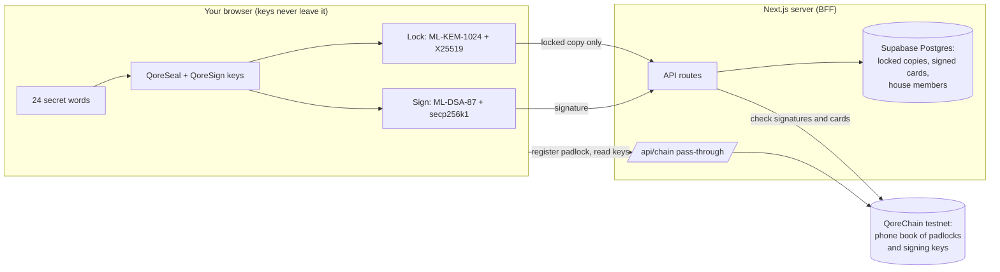

# Lockhouse

**Your peace, under lock and key. Not even Q-Day gets in.**

[](https://build.qorechain.io/p/lockhouse)

Lockhouse is a house for your family's important papers. Everything you put in is locked on your own device first, for you and the people you pick, with a lock that quantum computers can't break. The locked copies can sit anywhere: a stranger's copy opens nothing, today or after Q-Day.

Built for QoreChain's **Build Before Q-Day** hackathon (Encrypted Apps). It runs on QoreChain's test network (`qorechain-diana`), never mainnet.

- Live demo: _added at deploy_
- Demo video: _added at submission_

## The problem

Photos of ID cards and family papers sit in chats, phone galleries and cloud backups. Anyone who gets a copy can read it. And copies locked the old way (with today's padlocks) will open once a big enough quantum computer exists. That day is called **Q-Day**.

## What it does

The rule: **this is a house, not everyone can enter.**

1. **Make your keys.** 24 secret words, made in your browser. They never leave it.
2. **Register your padlock.** Your public ML-KEM-1024 key (the padlock) goes into QoreChain's public phone book, next to your ML-DSA-87 signing key. A **signed card** ties both to your address, so nobody can slip in a fake padlock for you.
3. **Sign in** with your key (Sign In With QoreChain). No password.
4. **Build the house.** Add the people you trust by their `qor1` address. Their card is checked against the chain first.
5. **Put in a paper.** Pick a file or write a note, tick who can open it. It is locked on your device (ML-KEM-1024 + X25519, one locked copy for all readers) and signed with your key before anything is sent. The server only ever stores the locked copy.
6. **Open it.** A reader's browser checks the sender's signature on chain, then opens the copy. A paper with a signature that doesn't check out is shown blurred, with "Signature Not Proven".
7. **The Q-Day Drill (Simulation).** Members can hand the drill their old key (X25519). A "Thief" with every stored copy and those old keys pretends Q-Day: copies locked the old way open, every Lockhouse copy stays shut, because it also needs the ML-KEM-1024 secret key that never left its owner's device.

Also built: remove someone from the house, a fake drop-in (a pretend hacked server slips in a paper it can't sign), and a **recovery key** for the house (a second set of 24 words, kept on paper, that is one more reader of every paper put in after it was made).

## How it works



- **Locking:** `@qorechain/qoreseal` seals one hybrid envelope (ML-KEM-1024 + X25519) with one entry per reader, and the paper's id as extra checked data, so a copy can't be moved to another paper.
- **Signing:** `@qorechain/qoresign` signs `lockhouse-item-v1|house|item|title|sha256(envelope)`. The server checks it against the sender's key on chain before it stores anything, and every reader checks it again.
- **Phone book:** padlocks and signing keys are registered on chain in two transactions per person (a small test-QOR fee, like a delivery fee for the network).
- **Server:** Next.js route handlers with the Supabase service role key. Tables have row-level security on and no policies, so the public Supabase API gets nothing. Sessions are signed, httpOnly cookies.

## Stack

Next.js 16 (App Router) + TypeScript + Tailwind 4 · Supabase Postgres · Vercel · Vitest · `@qorechain/qoreseal` 0.1.0 · `@qorechain/qoresign` 0.2.0 · cosmjs · `@scure/bip39`. No smart contract.

## Run it locally

```bash
npm install
cp .env.example .env.local          # then fill SUPABASE_URL and SUPABASE_SERVICE_ROLE_KEY
npm run test:accounts               # makes SESSION_SECRET and 3 throwaway test accounts, prints their addresses
# apply supabase/migrations/*.sql to your Supabase project, in order
# fund the 3 addresses with test QOR at https://dashboard.qorechain.io/faucet
npm test                            # Vitest: unit + integration (Supabase + testnet)
npm run dev                         # http://localhost:3000
```

`npm run build && npm run check:build` builds and checks that no server secret ended up in the browser files.

## Honest limits

What Lockhouse does not do, in plain words:

- **The lock hides what's inside, not the rest.** Who sent something to whom, when, how big it is, and the title are not hidden. Titles are seen by everyone in the house.
- **Once someone opens a paper, it's on their device.** That's why the house is only for people you trust.
- **Removing someone doesn't take back what they already opened.** It only stops them opening the house from now on.
- **Lost secret words lose what was locked for them,** unless the house made a recovery key before that paper was put in.
- **The recovery key only opens papers put in after it was made.** Papers put in before it can't be opened with its words.
- **If the person who made the recovery key is removed, the key is dropped** (they saw its words). The house can make a new one. Papers already locked to the old key still open with the old words.
- **It protects things from now on.** Papers that already leaked stay leaked.
- **It doesn't stop someone stealing a locked copy; it makes the copy useless.** A hacked phone, laptop or browser extension is outside it: your secret words live in this browser's storage.
- **The member list lives on our server.** The server can't open a paper or fake a signature, but a hacked server could hide, delete or refuse to store a locked copy, or add a stranger to the member list. Lockhouse shows every member by name and address, and who made the recovery key; check the list before you pick readers.
- **Names are what each person types.** They are not unique; the address next to each name is what counts.
- **Any member can add someone whose own house is empty,** without asking them first.
- **The drill is pretend, and says so.** Only the Thief's power is pretend; everything else really runs on testnet. Giving your old key to the drill publishes your X25519 key, so after that your papers rest on ML-KEM-1024 alone. Use test accounts for the drill.
- **The fake drop-in is real data.** It stores a marked paper ("Fake Drop-In (Simulation)") in your house list.
- **QoreSeal is a draft.** QoreChain calls it a draft until an outside review before version 1.0.
- **It runs on QoreChain's test network.** The explorer link opens on Mainnet; switch it to Testnet at the top.

## Security review

This is a hackathon review, not an audit. Get a proper audit before any real papers or funds.

Checked on 24 Nov 2026 with Claude Code (`/code-review` and a manual pass over every route, migration and screen):

- **Fixed:** opened SVG pictures were shown from a `blob:` URL, which carries this site's origin; opened in their own tab, a crafted SVG could have run script here and read the secret words. They now show from a `data:` URL. Other sites can no longer put Lockhouse in a frame (`frame-ancestors 'self'`). Put In now names who made the recovery key. Smaller fixes: a title with spaces around it, a future-dated sign-in message, a clearer error when the recovery key changed mid-put-in.
- **Checked, nothing found:** no secret in the git history (gitleaks, all commits) or in the browser files (`check:build`); `npm audit` 0 for production packages; every member route checks the session and the house; the chain pass-through only reaches a fixed list of testnet paths; the database is closed to the public Supabase API.
- **Left open (see Honest limits):** the server holds the member list; no rate limits; the chain pass-through forwards any signed testnet transaction; the drill publishes the old keys it is given.

## Credits

- QoreChain's `@qorechain/qoreseal` and `@qorechain/qoresign` kits, and their testnet examples: transactions are built the same way.
- The Workshop 3 example in [qorechain/build-before-qday](https://github.com/qorechain/build-before-qday) (`workshop-3/01-qoreseal`, Apache-2.0): seal, open, the thief who can't, two readers.
<!-- TODO Laras: where the house pictures in public/img/house came from -->

## Team

Solo build by [ervhint](https://github.com/ervhint), with Claude Code. How AI was used: [AI_USAGE.md](AI_USAGE.md).

## License

[Apache-2.0](LICENSE)
