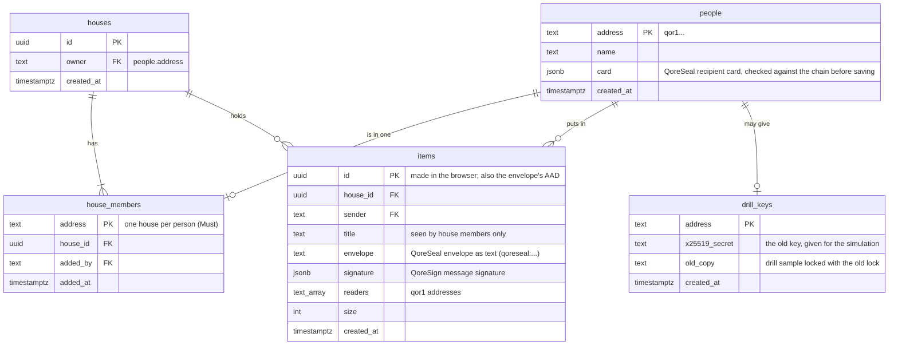

# Lockhouse: plan

*§1 written 23 Nov 2026 (P1, chat lockhouse-01). The idea is Laras's and is final: [internal/qorechain-2026-final-idea.md](../internal/qorechain-2026-final-idea.md). This file only adds what the build needs. §2–§6 written 23 Nov 2026 (P5), after reading both kits' type files and their testnet examples.*

## 1. Context and golden path

### 1.1 Problem, user, differentiator (short; full text in the final idea file)

- **Problem:** KTP and KK photos sit in chats, galleries and cloud backups, where anyone with a copy can read them. Copies locked the old way open after Q-Day.
- **User:** you and the people in your house (your family, or anyone you trust). Demo accounts: three family members with made-up names, **Ayu** ("Me", the house owner), **Tari** (her sister) and **Ratna** (their mom), plus a **Thief**. The app always shows each person's own name, never "Me", "Sister" or "Mom" (see [DESIGN.md](DESIGN.md) "Names").
- **The rule:** "This is a house, not everyone can enter."
- **Differentiator:** a family house where sharing uses the new padlock (ML-KEM-1024 via QoreSeal), each person's keys stay on their own device, the padlocks sit in QoreChain's public phone book, and what family members put in for each other is signed (QoreSign). Closest outside: Ente Locker (old padlock), Qpher Vault (company keeps the keys). None of 133 fest projects is a family house.

### 1.2 Golden path (the 60–90-second demo)

Before recording: the three family accounts are set up (padlocks registered on testnet, signed cards published) and the Thief window is open. All papers are made-up samples.

1. **Ayu's house.** Ayu's window shows the house: Ayu, Tari and Ratna, each with a "Padlock in the Phone Book ✓" badge that links to the registration on the testnet explorer.
2. **The gate.** Ayu drops in the sample family KK and ticks Tari and Ratna. The screen shows it being locked in this browser ("Locked on This Device · ML-KEM-1024 + X25519 · 3 readers") before it's sent. Only the locked copy is stored.
3. **Tari opens it.** In Tari's window the KK appears, "Put in by Ayu". Tari opens it; it unlocks in her browser.
4. **Ratna opens the same lock.** In Ratna's window the same single locked copy opens too (one lock, many readers).
5. **Ratna puts something in for Ayu.** Ratna puts in a private note for Ayu. It's locked to Ayu's padlock and signed. In Ayu's window it shows "From Ratna · Signature Checked on QoreChain ✓".
6. **The drill (labelled "Simulation").** The Thief window already holds every stored copy (the store is public: a copy opens nothing). The Thief presses "Pretend Q-Day": the Thief is handed the old keys, as a quantum computer would work them out. The old-lock copy of the sample KTP opens; every Lockhouse copy stays shut.
7. **The family is still fine.** Back in Tari's window, the KK still opens. End card: the tagline.

Steps 2–6 are each about 10–15 seconds. The account setup (making keys, registering the padlock) is shown in the longer video, not in these 90 seconds.

### 1.3 How it meets the score

| Part (weight) | Golden-path step |
| --- | --- |
| Works as described (25%) | Every step runs on testnet; only the Thief's power in step 6 is pretend, and it says so |
| QoreChain tech usage (25%) | Step 1 (PQC key + KEM key registration, signed cards), step 2 (QoreSeal in the browser), step 5 (QoreSign checked against chain) |
| Post-quantum correctness (20%) | Step 6: the old lock breaks, the hybrid lock holds because of ML-KEM-1024; honest limits in the README |
| Originality (15%) | The family house itself (steps 1, 3–5) |
| Clarity, UX, docs (15%) | One gate, one list, one drill; the README limits |
| Best AI-Native Build ($500) | `AI_USAGE.md` from the notes in `internal/ai-usage-notes.md` |

### 1.4 Scope (MoSCoW)

| | What |
| --- | --- |
| **Must** | Sign in with your QoreChain key (Sign In With QoreChain, so only you can add to your house) · add a family member by their qor1 address (their signed card is checked first) · make your keys in the browser from secret words (shown once as the backup) · register the padlock: ML-DSA-87 key with proof of possession, then `MsgRegisterKEMKey`, plus the signed card · the house list (members, their badges) · the gate: lock in the browser for chosen members, store only the locked copy · the house's item list · open in the browser · a family member's signed drop-in, checked against the chain · the drill (old-lock copy + Thief, labelled "Simulation") |
| **Should** | A photo size limit with a clear message · explorer links on every on-chain step |
| **Could** | Being in several houses (a house picker) · a recovery key · a fake "from Ratna" drop-in being refused on screen · remove a member · group keys that stop a removed member reading new items |
| **Won't** | Mainnet · an app to install · offline/Bluetooth · messaging · "after I'm gone" · the QoreX wallet as the key holder (it can't give the house its lock keys; see 1.5) |

### 1.5 Technical answers found in P1 (checked 23 Nov)

- **QoreSeal works in the browser.** `@qorechain/qoreseal` 0.1.0 and `@qorechain/qoresign` 0.2.0 are pure JavaScript (noble/scure libraries, no Node-only imports). Both have everything the build needs: `seal`/`open`, `deriveSealKeys`, `buildRegisterKemKeyMessage`, `signRecipientCard`/`verifyRecipientCard`, `buildRegisterPqKeyMessage`, `signProofOfPossession`, `signHybrid`, `broadcastTx`, `signMessage`, `verifyMessageWithChain`, `signSiwq`/`verifySiwqWithChain`.
- **Keys live in the browser.** Each person's secret words are made in their browser and kept there; the words are the backup and the way onto a new device. The keys never reach our server. QoreX can't be the key holder, because the house needs lock keys made from the secret words and a wallet doesn't hand those out.
- **Gas:** each family account needs test QOR for its two registrations (faucet: 100 per 24 h). The Thief needs none.
- **Where locked copies go:** a hosted database that only ever holds locked copies (Supabase), reached through our own server routes. Not on chain: a KTP photo is about 150–500 KB, too big for a transaction.
- **Size:** a locked copy is the file + 56 + 1,664 bytes per reader (3 readers ≈ 5 KB extra).
- **The drill:** the old-lock copy uses only X25519 (the classical part). The Thief is handed the X25519 secret keys. That opens the old-lock copy, but not the Lockhouse copy, because its ML-KEM-1024 part is still missing. This follows the sponsor's drill: the thief gets the old keys, nothing for the new lock.
- **Demo windows:** settled at G2 (see [DESIGN.md](DESIGN.md) "G2 answers"): Ayu and Tari on phones, Ratna and the Thief on the PC in two browsers. Build and test with four Chrome profiles.

### 1.6 Open questions

1. ~~Accounts~~ Settled 23 Nov: GitHub https://github.com/ervhint/lockhouse (public, empty, created 23 Nov) · Supabase org `ervhint`, Staging `egtxrdfhmtdiujdiywkm`, Prod `htghbmdautdpgzalysko` · Vercel team `ervhint`, project `lockhouse-qorechain` (created 23 Nov, no deploy yet; lockhouse-qorechain.vercel.app was free on 23 Nov and is claimed at the first production deploy in P7).
2. ~~Recovery key~~ Settled 23 Nov: **Could** (Laras: "if we have time, we might build it"). Until then the secret words are the backup, and the README says so.
3. ~~Fest feed and the repo~~ Settled 23 Nov: the repo is public and linked, the QoreChain Build app is installed, and the first commit is counted. AI-Native and Regional Indonesia are saved on the project page.
4. Keep checking until the deadline: the drill's attack log, look-alike projects, rule changes.

### 1.7 Stack

Next.js (App Router) + TypeScript + Tailwind · our own server routes for the store (rule 13) · Supabase Postgres for locked copies and house membership (no Supabase Auth: you sign in with your QoreChain key) · Vercel · Vitest · `@qorechain/qoreseal`, `@qorechain/qoresign` (both counted as kits on the project page). No smart contract, so no Foundry and no `test` branch.

## 2. Non-functional (measurable)

| ID | Rule | How it's checked |
| --- | --- | --- |
| NF-1 | Every screen works at 375px (phones) and 1440px, with no sideways scroll | Chrome at both widths, every page state (TESTS.md "Page states") |
| NF-2 | Secret words, secret keys, files and notes never leave the browser. The only exception is the drill's X25519 secret key (the old lock), given on purpose and labelled "Simulation" | Network tab on each golden-path step; route tests refuse unknown fields |
| NF-3 | Only the testnet: chain id `qorechain-diana`, REST https://api-testnet.qore.host. No setting can point the app at mainnet | One constant in one settings module; the chain pass-through only knows the testnet host |
| NF-4 | A file can be up to **2 MB** (a phone photo of a paper fits; Vercel accepts 4.5 MB per request, and the locked copy is sent as text, about 1.35× bigger) | U5 too-big test |
| NF-5 | On the PC: locking 500 KB for 3 readers takes under 2 s, and opening it under 2 s (chain checks not counted) | Timed in Chrome in U5 and U6 |
| NF-6 | A testnet transaction shows Pending at once and Confirmed or Failed within 60 s | U2 |
| NF-7 | Server secrets (`SUPABASE_SERVICE_ROLE_KEY`, `SESSION_SECRET`) never reach the browser; no `NEXT_PUBLIC_` variables are needed | Search the built browser files in U0 |
| NF-8 | RLS is on for every table, with no policies for `anon` or `authenticated`: only our server routes (service role) read or write | Supabase advisors in U0 and U4 |
| NF-9 | Keyboard works on every screen, focus is visible, text contrast is AA | `better-interface` on each unit |
| NF-10 | Every error says what happened and what to do next (no bare "Something went wrong") | Each unit's error states |

## 3. Data, routes and keys

### 3.1 What is stored where

| Where | What | Who can read it |
| --- | --- | --- |
| **The browser** (localStorage, this device only) | Your secret words and your name. Every key is made again from the words when needed: the classical key and qor1 address, the ML-DSA-87 signing key, the QoreSeal keys (ML-KEM-1024 + X25519) | Only this browser |
| **QoreChain testnet** (the public phone book) | Your ML-DSA-87 signing key (with its proof) and your ML-KEM-1024 padlock | Everyone |
| **Supabase Staging** (through our server only) | Names, signed cards, houses, members, locked copies, signatures | Only our server routes |

### 3.2 Tables (Supabase Postgres)

One migration file per unit that adds tables (U3: people, houses, house_members · U5: items · U7: drill_keys), applied to **Staging** `egtxrdfhmtdiujdiywkm` only.

### 3.3 Server routes (the BFF)

| Route | Who | Does |
| --- | --- | --- |
| `GET/POST /api/chain/[...path]` | anyone | Pass-through to the testnet REST, only for the paths the kits use (account info, balances, PQ key, KEM key, simulate, broadcast, tx lookup). The kits take a `rest` address, so the browser gives them `/api/chain` (D-03) |
| `GET /api/auth/nonce` · `POST /api/auth/verify` · `POST /api/auth/sign-out` | anyone | Sign In With QoreChain (U3) |
| `GET /api/house` · `POST /api/house/members` | house members | House, members, item list; add a member (U4, U5) |
| `POST /api/items` · `GET /api/items/[id]` | house members | Put in; get one item for a reader (U5, U6) |
| `GET /api/drill` · `POST /api/drill` | anyone · members | Every stored copy with no title, names or readers (`id, envelope`), plus the old-lock copies and given old keys; give my old keys (U7). One route instead of the planned `/api/copies` + `/api/drill`: the Drill needs both at once |
| `POST /api/drill/fake` | members | Try a Fake Drop-In (U8, Simulation): plays a hacked server. Locks a made-up note to me, signs it with a throwaway key and stores it as if another member of my house sent it. Opening it shows Signature Not Proven |

### 3.4 Env vars

`SUPABASE_URL`, `SUPABASE_SERVICE_ROLE_KEY`, `SESSION_SECRET` (server only) · `TEST_MNEMONIC_1`, `TEST_MNEMONIC_2`, `TEST_MNEMONIC_3` (throwaway testnet accounts, tests only). All in the gitignored `.env.local`; names only in `.env.example`. The chain id, REST address, explorer and faucet links are fixed facts, written once in code, not env vars.

### 3.5 Web3: money, powers, rules that always hold, transaction states

**Asset flows.** The only money that moves is test QOR for gas: each family account pays the network a small fee (about 0.04 test QOR per registration at 0.1 uqor per gas) for its own two registrations. Test QOR comes from the faucet (100 per 24 h). No contract, no transfers between people, no tokens. The Thief and the server hold no QOR.

**Permissions.** No admin and no contract. The person who starts a house is its owner; any member can add someone (G2). Nobody can remove anyone yet (Could, U9). The server can't open any paper or forge a signature. It *could* hide or delete a locked copy, or refuse to store one; that is in the README limits.

**Invariants (must always hold):**
- INV-1: the server never receives secret words, an ML-KEM-1024 secret key, an ML-DSA-87 secret key, a file or a note. (Only the drill's X25519 key, on purpose.)
- INV-2: every stored item's signature checks out against its sender's ML-DSA-87 key on chain, over `lockhouse-item-v1|{houseId}|{itemId}|{title}|{sha256 of the envelope}`.
- INV-3: every reader of an item was a member of that house, with a card that checked out against the chain, when it was put in. The sender is always a reader.
- INV-4: an envelope opens only with its own item id as AAD (extra data that is checked but not hidden), so a copy can't be moved to another item.
- INV-5: everything uses chain id `qorechain-diana`.

**Transaction states.**

| Action | On chain? | States |
| --- | --- | --- |
| Register signing key (`MsgRegisterPQCKeyV2`, classical-only signature) | yes, gas | not enough test QOR → waiting for your approval → said no (nothing sent) → pending → confirmed (explorer link) / failed (reason, retry) |
| Register padlock (`MsgRegisterKEMKey`, hybrid signature) | yes, gas | same as above |
| Sign the recipient card | no (a signed message) | made in the browser after the padlock confirms |
| Sign in | no (a signed message) | signing → in / failed |
| Sign a paper when putting it in | no (a signed message) | locking → signing → saved / save failed |

## 4. Build phases and units

**Order (rule: setup → shared functions → demo Musts in golden-path order):** U0 → U1 → U2 → U3 → U4 → U5 → U6 → U7. Coulds U8–U10 only if time allows. Each unit is one chat. Every Must story has a unit (US-02, US-07, US-09 are Shoulds, folded into U1, U2/U4 and U5 because each is a few lines).

Every unit also: replaces that page's mock data and `?state=` jumps with the real flow, uses the shared components (AGENTS.md), and passes `better-interface`. "Est" is a rough guess for one chat.

### Phase A: Setup (testable: `npm test` runs)

### U0 — Skeleton, test setup and architecture  (Must)
Covers: —      Screens: —      Depends on: —      Est: 2h      Model: Sonnet 5.5 · medium
Installs the kits and the three cosmjs packages their testnet examples use (`@cosmjs/proto-signing`, `@cosmjs/amino`, `cosmjs-types`, for building transactions), `@scure/bip39` (secret words), `@supabase/supabase-js` and Vitest. Sets up `npm test`, one GitHub Actions job on `main`, `.env.example`, the one settings module (chain id, REST, explorer, faucet, the item purpose `lockhouse-item`), and three throwaway test accounts (secret words only in `.env.local`). Checks §3 against what the kits really need and records the commands, routes and env vars in AGENTS.md.
Acceptance:
- AC-0.1 Given a fresh checkout with `.env.local`, when Laras runs `npm test`, then the suite runs on localhost and passes.
- AC-0.2 Given two key pairs from two test accounts' secret words, when a test seals one note to both and opens it with each, then both get the note back, and a third key pair gets `NOT_A_RECIPIENT` (one lock, many readers).
- AC-0.3 Given a hybrid envelope, when a test opens it with the right X25519 secret key but not the ML-KEM-1024 secret key, then it fails (this proves the drill works before U7).
- AC-0.4 Given a push to `main`, when GitHub Actions runs, then the same suite passes in one job (repo secrets set by Laras).
- AC-0.5 Given `next build`, when the browser files are searched, then no server secret appears.
- AC-0.6 Given a staged fake key, when committing, then the gitleaks hook blocks it.
Tests: T-0.1 (unit), T-0.2 (unit), T-0.3 (unit), T-0.4 (CI), T-0.5 (build check), T-0.6 (hook check)
Laras: send each test account test QOR from the faucet (the unit prints the three qor1 addresses); add the GitHub Actions secrets.

### Phase B: Keys, padlock, sign-in (testable: a new person gets keys, registers on testnet, signs in)

### U1 — Make, back up, restore and forget my keys  (Must; restore is Should)
Covers: US-01, US-02      Screens: S-01, S-02, S-03, the Forget Keys sheet      Depends on: U0      Est: 2h      Model: Opus 5.5 · medium
Acceptance:
- AC-1.1 Given no keys in this browser, when I type my name and press Make My Keys, then 24 secret words are made in the browser, kept in this browser with my name, and no request carries them (network tab).
- AC-1.2 Given the backup screen, when it opens, then the words show once; Continue stays off until I tick that I wrote them down; after I leave, no screen shows them again.
- AC-1.3 Given keys in this browser, when I open Welcome, then it shows the returning state with my name and the next step (register padlock, sign in, or go to the house).
- AC-1.4 Given my secret words, when I restore them in another Chrome profile, then the same qor1 address comes back.
- AC-1.5 Given wrong words (wrong count or a typo that fails the checksum), when I restore, then the inline error shows and nothing is kept.
- AC-1.6 Given an empty name, when I press Make My Keys, then an inline error shows.
- AC-1.7 Given Forget Keys on This Device, when I confirm in the sheet, then the words and name leave this browser, I'm signed out (after U3), and Welcome shows the first-visit state.
Tests: T-1.1 (unit: same words → same address, signing key and QoreSeal keys), T-1.2 (e2e), T-1.3 (e2e), T-1.4 (unit + e2e), T-1.5 (unit), T-1.6 (e2e), T-1.7 (e2e)

### U2 — Register my padlock in the phone book  (Must · demo setup)
Covers: US-03, US-07      Screens: S-04      Depends on: U1      Est: 3h      Model: Opus 5.5 · high
Two real testnet transactions, built the way the kits' own examples do (QoreSign `register-and-send`, QoreSeal `register-and-encrypt`): first the ML-DSA-87 signing key with its proof of possession, then the ML-KEM-1024 padlock. Each one waits for my approval in the page. All chain calls go through `/api/chain`.
Acceptance:
- AC-2.1 Given an account with no test QOR (the chain doesn't know it yet) or less than 1 test QOR, when the page loads, then it shows Not Enough Test QOR with my address to copy and the faucet link; Check Again reads the balance again.
- AC-2.2 Given enough test QOR, when I press Register My Padlock, then Signature 1 of 2 says in plain words what it signs, and nothing is sent until I press Approve in This Browser.
- AC-2.3 Given an approval step, when I press Not Now, then "You said no to signing. Nothing was sent." shows, and Try Again goes back to that same step.
- AC-2.4 Given I approve both, when each is sent, then it shows Pending, then Confirmed with an explorer link for that transaction; afterwards the chain shows my signing key (proof of possession: yes) and my ML-KEM-1024 padlock.
- AC-2.5 Given step 1 is already on chain (a reload or a second visit), when the page loads, then it starts at step 2; given both are, it shows Confirmed and Continue.
- AC-2.6 Given the chain refuses a transaction or it isn't confirmed within 60 s, then Failed names the step, gives the reason in plain words (the kits' error text when there is one) and a Try Again that doesn't redo a finished step.
- AC-2.7 Given both are confirmed, then my recipient card is signed in the browser and checks out against the chain (it is saved at sign-in, U3).
- AC-2.8 Given a request to `/api/chain` for a path not on its list, or another host, then it answers 404 and forwards nothing.
Tests: T-2.1 (e2e), T-2.2 (e2e), T-2.3 (e2e), T-2.4 (integration on testnet + e2e), T-2.5 (e2e), T-2.6 (unit: error text + e2e), T-2.7 (integration), T-2.8 (unit)

### U3 — Sign in with QoreChain  (Must)
Covers: US-04      Screens: S-10, Sign Out in the menu      Depends on: U2      Est: 2.5h      Model: Opus 5.5 · high
Acceptance:
- AC-3.1 Given my padlock is registered, when I press Sign In With My Key, then the browser signs a Sign In With QoreChain message (this site's domain, chain `qorechain-diana`, a nonce from our server, my name in the statement), the server checks it against my ML-DSA-87 key on chain, and I land on the House with a session cookie (httpOnly, SameSite=Lax, Secure when deployed, 7 days).
- AC-3.2 Given my first sign-in, then my name and recipient card are saved (the card is checked against the chain first) and a house with only me in it is made.
- AC-3.3 Given a wrong nonce, another domain, a message older than 10 minutes, or an account with no signing key on chain, when the server checks it, then it refuses, nothing is saved, and the page shows "Sign-in failed. Try again."
- AC-3.4 Given a nonce that was already used, when it is sent again, then it is refused.
- AC-3.5 Given no session, when I open the House, Add Member, Put In or an item, then I'm sent to Sign In; the member-only API routes answer 401.
- AC-3.6 Given Sign Out, when I press it, then the session ends and Welcome shows; my keys stay in this browser.
- AC-3.7 Given a session but no keys in this browser, when I open a house page, then I'm sent to Welcome to restore my keys.
Tests: T-3.1 (e2e golden + integration), T-3.2 (integration), T-3.3 (unit, 4 cases), T-3.4 (unit), T-3.5 (integration), T-3.6 (e2e), T-3.7 (e2e)

### Phase C: The house (testable: a house of three, each badge real; golden step 1)

### U4 — House members and Add Member  (Must · demo-critical)
Covers: US-05, US-06, US-07      Screens: S-05 (members part), S-06      Depends on: U3      Est: 3h      Model: Opus 5.5 · high
Acceptance:
- AC-4.1 Given I'm signed in, when the House loads, then each member shows their own name, short qor1 address and a "Padlock in the Phone Book ✓" badge that links to their address on the explorer; the badge is read from the chain, not from our database.
- AC-4.2 Given I'm the only member, then the No Other Members empty state shows with Add Someone.
- AC-4.3 Given the qor1 address of someone who has registered and signed in once, when I press Add, then the server checks their card against the chain and they show on my House within 2 s; in their window, after a reload, they see my house.
- AC-4.4 Given an address with no padlock on chain, or someone who has never signed in, then "This address has no padlock in the Phone Book yet…" shows and nothing is added.
- AC-4.5 Given a card that no longer matches the chain (for example a changed padlock), then "Their signed card does not match this address. Nothing was added." shows.
- AC-4.6 Given someone whose own house has other members or papers, then "They are already in another house" shows and nothing changes; given someone alone in an empty house, then they move into mine and their empty house is removed.
- AC-4.7 Given text that isn't a qor1 address, then an inline error shows before any request.
- AC-4.8 Given someone outside the house, when they ask for this house's data, then they get 403.
- AC-4.9 Given loading or a refresh after adding, then the skeleton or "Updating the list…" shows.
Tests: T-4.1 (e2e golden), T-4.2 (e2e), T-4.3 (integration + e2e), T-4.4 (integration), T-4.5 (unit), T-4.6 (integration, 2 cases), T-4.7 (unit), T-4.8 (integration), T-4.9 (e2e)

### Phase D: Put in and open (testable: golden steps 2–5)

### U5 — The gate: lock, sign and put in, and the house's paper list  (Must · demo-critical)
Covers: US-08, US-09, US-10, US-11      Screens: S-07, S-05 (items part)      Depends on: U4      Est: 3h      Model: Opus 5.5 · medium
Acceptance:
- AC-5.1 Given a file (image or PDF) up to 2 MB, or a note, a title, and readers ticked from the house (my own name is always ticked and can't be unticked), when I press Lock and Put In, then the browser checks each reader's card against the chain, seals one hybrid envelope (ML-KEM-1024 + X25519, purpose `lockhouse-item`, the item id as AAD), and shows "Locked on This Device · ML-KEM-1024 + X25519 · {readerCount} readers" before anything is sent.
- AC-5.2 Given the locked copy, then the browser signs it with QoreSign (INV-2) and sends only the item id, title, envelope, signature and reader addresses; the file name and type travel inside the envelope.
- AC-5.3 Given a put-in request, the server stores it only if I'm in the house, every reader is in the house, the envelope reads as a hybrid QoreSeal envelope with one entry per reader, it is within the size limit, and the signature checks out against my key on chain; otherwise it answers 400 and stores nothing.
- AC-5.4 Given a file over 2 MB, then the inline error shows its size and the limit, and nothing is locked.
- AC-5.5 Given an empty title (or over 80 characters), then an inline error shows.
- AC-5.6 Given the save fails, then "Could not save. Nothing was sent. Try again." shows, and Try Again works without picking the file again.
- AC-5.7 Given it saved, then the toast shows the reader count with a link to the House, and the House lists the paper with its title, "Put in by {senderName}", date and reader count, newest first; with no papers the No Papers empty state shows.
- AC-5.8 Given 500 KB for 3 readers on the PC, then locking takes under 2 s (NF-5).
Tests: T-5.1 (e2e golden), T-5.2 (integration: route refuses unknown fields), T-5.3 (integration, 5 cases), T-5.4 (unit + e2e), T-5.5 (e2e), T-5.6 (e2e), T-5.7 (e2e), T-5.8 (timed e2e)

### U6 — Open a paper and see who put it in  (Must · demo-critical)
Covers: US-12, US-13      Screens: S-08      Depends on: U5      Est: 2.5h      Model: Sonnet 5.5 · medium
Acceptance:
- AC-6.1 Given I'm a reader, when I open a paper, then the browser checks the signature against the sender's ML-DSA-87 key on chain, opens the envelope with my keys and shows the picture, PDF or note with "From {senderName} · Signature Checked on QoreChain".
- AC-6.2 Given two other readers, when each opens the same paper in their own window, then it opens for each, from the one stored copy (one row in the database).
- AC-6.3 Given I'm in the house but not a reader, then "This Paper Is Not for You" shows and the locked copy isn't sent to me.
- AC-6.4 Given the signature doesn't check out (title or copy changed in the database), then "Signature Not Proven" shows above a blurred preview (or no preview if it can't be opened), and there is no Download.
- AC-6.5 Given Download Paper, then the original file comes back with its own name and type.
- AC-6.6 Given it's working, then Opening on This Device shows; 500 KB opens in under 2 s on the PC (NF-5).
- AC-6.7 Given someone outside the house, when they ask for the item, then they get 403.
Tests: T-6.1 (e2e golden), T-6.2 (e2e golden + DB check), T-6.3 (e2e + integration), T-6.4 (integration: change a row on Staging, then e2e), T-6.5 (e2e), T-6.6 (timed e2e), T-6.7 (integration)

Golden step 5 (a member puts something in for the owner) is U5 + U6 with one other reader.

### Phase E: The drill (testable: golden steps 6–7)

### U7 — The Q-Day Drill (Simulation)  (Must · demo-critical)
Covers: US-14, US-15      Screens: S-09      Depends on: U6      Est: 3h      Model: Opus 5.5 · medium
QoreSeal has no "old lock only" mode, so the drill's old lock is ours: X25519 + HKDF-SHA-256 (both from QoreSeal's own exports) + AES-256-GCM (the browser's built-in WebCrypto). The drill sample is a made-up paper picture that ships with the app.
Acceptance:
- AC-7.1 Given anyone (no keys, not signed in, like the Thief window), when they open the Drill, then it lists every stored copy with no title, names or readers: Lockhouse copies marked "Locked With ML-KEM-1024" and old-lock copies marked "Locked With the Old Lock". "Simulation" shows on the page at all times.
- AC-7.2 Given a signed-in member, when they press Give My Old Keys to the Drill (Simulation) and confirm, then their browser locks the drill sample with the old lock to their own X25519 key and sends that old-lock copy and their X25519 secret key, and nothing else (no secret words, no ML-KEM-1024 or ML-DSA-87 key).
- AC-7.3 Given given old keys, when the Thief presses Pretend Q-Day, then, in the Thief's browser, each old key is tried on every stored copy: every old-lock copy opens and shows the drill sample; every Lockhouse copy stays shut, with the reason ("the ML-KEM-1024 part is missing").
- AC-7.4 Given no old keys were given yet, when the Thief presses Pretend Q-Day, then the page says a family member must give their old keys first.
- AC-7.5 Given the drill ran, when a member opens their papers, then they still open (T-6.1 run again).
- AC-7.6 Given the old lock alone, then it opens with the right X25519 key and fails with any other.
- AC-7.7 Given the whole app, then no page uses `?state=` and the prototype's StatePicker is deleted (and removed from AGENTS.md).
Tests: T-7.1 (e2e golden), T-7.2 (e2e + network check), T-7.3 (e2e golden), T-7.4 (e2e), T-7.5 (e2e golden), T-7.6 (unit), T-7.7 (code search)

**Checkpoint:** after U7 the whole golden path (§1.2) runs on localhost in four Chrome profiles.

### Phase F: Coulds (only if time allows, in this order)

### U8 — A fake "from someone" paper is refused on screen  (Could)
Covers: US-17      Screens: S-08, S-09      Depends on: U7      Est: 1.5h
- AC-8.1 Given the drill, when a member presses Try a Fake Drop-In (Simulation), then a copy that claims to be from another member but is signed with the wrong key is stored as if our server were hacked, and opening it shows Signature Not Proven. Tests: T-8.1 (e2e)

### U9 — Remove someone from the house  (Could)
Covers: US-18      Screens: S-05      Depends on: U7      Est: 1.5h
- AC-9.1 Given a member, when another member removes them and confirms, then they leave the list and can't open the house. The sheet says plainly that what they could already open stays on their device (honest limit). Tests: T-9.1 (e2e)

### U10 — Recovery key  (Could)
Covers: US-16      Screens: S-03, S-07      Depends on: U7      Est: 2h
- AC-10.1 Given a house with a recovery key (separate secret words, kept on paper), when anything is put in, then the recovery key is one more reader, and those words open it on a new device. Tests: T-10.1 (integration + e2e)

**Won't in this build:** group keys (US-19), a house picker (being in several houses).

## 5. Decisions log

| ID | Date | Decision | Why |
| --- | --- | --- | --- |
| D-01 | 23 Nov | Keys are made from 24 secret words with the kits' own functions (`deriveClassicalKey`, `deriveCanonicalPqKey`, `deriveSealKeys` index 0); only the words and the name are kept, in localStorage | One backup for everything; nothing to sync. A hacked device is outside the lock (README limit) |
| D-02 | 23 Nov | Order is keys → padlock → sign-in. Sign-in needs the padlock first | `verifySiwqWithChain` refuses an account with no ML-DSA-87 key on chain (QoreSign 0.2.0 types) |
| D-03 | 23 Nov | Every chain call from the browser goes through one pass-through route, `/api/chain`, with a fixed list of paths | The kits accept any `rest` address, so no extra code; no CORS risk; rule 13 (the browser talks to our server) |
| D-04 | 23 Nov | Transactions are built like the kits' testnet examples: cosmjs `TxBody` + `makeAuthInfoBytes`, fee 0.1 uqor per gas, gas from `simulateTx`, sent with `submitWithSignBytesFallback` (hybrid) or `broadcastTx` (classical-only key registration) | Copying the sponsor's working recipe is the safest; credit in the README |
| D-05 | 23 Nov | The name is in the signed Sign In With QoreChain statement; the card is saved at sign-in after the server checks it against the chain | The name is proven to come from that account, with no extra signature or route |
| D-06 | 23 Nov | Session: an httpOnly cookie signed with `SESSION_SECRET` (HMAC, Node's built-in crypto); the nonce is a short-lived signed cookie that is cleared when used | No auth library, no session table. U3 (24 Nov): a cookie alone can be replayed, so used nonces go in a `used_nonces` table (AC-3.4); `sign_in` uses up the nonce and saves in one call |
| D-07 | 23 Nov | One house per person (Must). First sign-in makes your own house; being added moves you only if your own house is empty | Keeps the house picker a Could (G2) |
| D-08 | 23 Nov | Locked copies are stored as text (`envelopeToText`) in Postgres, not in Supabase Storage | 2 MB limit; one table; no file bucket rules |
| D-09 | 23 Nov | Each envelope uses purpose `lockhouse-item` and its item id as AAD; the signature covers house, item, title and the envelope's hash | A copy can't be moved to another item or retitled without the signature failing |
| D-10 | 23 Nov | Every member's padlock badge is read live from the chain | The badge proves what the phone book says, not what our database says |
| D-11 | 23 Nov | The drill's old lock is our own: X25519 + HKDF-SHA-256 + AES-256-GCM. The Thief gets only X25519 secret keys, given on purpose by members | QoreSeal has no X25519-only mode; this follows the sponsor's drill (the thief gets the old keys, nothing for the new lock) |
| D-12 | 23 Nov | The store is public through `/api/copies` (copies only, no titles, names or readers); titles are seen only by house members | The golden path says a copy opens nothing; titles are kept from strangers |
| D-13 | 23 Nov | S-10 loses its "Rejected" state: pressing Sign In With My Key is the approval. S-04 keeps its two approvals with Not Now | Keys live in the page, so there is no wallet pop-up to say no to at sign-in |
| D-14 | 23 Nov | The sender is always a reader of what they put in | They can see what they sent; one rule |
| D-15 | 23 Nov | The test plan was written in the main chat, not by a subagent | All acceptance criteria were already here; a subagent would re-read everything |

## 6. Open questions

1. ~~For Laras at G5~~ Settled 23 Nov: Laras kept all four picks: D-12 (titles hidden from the public store, seen by the house), NF-4 (2 MB limit), D-13 (no Rejected state at sign-in), D-14 (sender always a reader).
2. ~~Explorer link format~~ Settled 23 Nov (U2): `https://explore.qore.network/tx/{hash}` and `/address/{qor1…}`. The explorer keeps Testnet/Mainnet in its own header switch (a cookie; `?network=testnet` does nothing), so the page says "Switch it to Testnet at the top". Faucet: https://dashboard.qorechain.io/faucet (needs sign-in there).
3. Keep checking until the deadline: the drill's attack log, look-alike projects, rule changes (from §1.6).
